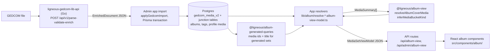

# Architecture: @ligneous/album-view

## Summary

`@ligneous/album-view` is a small TypeScript package with no runtime dependencies. It defines one view model, `MediaSetViewModel`, for any set of media in a family tree: a curated album that an editor built, or a generated set such as "all media for this person". It also holds three pure helpers that both apps need to agree on: which item becomes the cover, what kind of file a media row is, and how to show and search GEDCOM names. It makes no database calls. The apps load rows through Prisma, map them to `MediaSummary` objects, and call these helpers to build the view model they send to the browser.

## Data flow

The admin app (the-gonsalves-family-admin, private) sends the uploaded GEDCOM file to [ligneous-gedcom-lib-api](https://github.com/lesfleursdelanuitdev/ligneous-gedcom-lib-api), which runs the [ligneous-gedcom-lib](https://github.com/lesfleursdelanuitdev/ligneous-gedcom-lib) parser and enricher and returns the `EnrichedDocument`. The admin app writes it to the `gedcom_*_v2` tables through the shared Prisma client (ligneous-prisma, private). The public site (the-gonsalves-family, private) and the admin app then read those tables. This package only sees the plain objects the resolvers build at the end of that chain.

## Files

| Path | Responsibility |
| --- | --- |
| `src/model.ts` | All types: `MediaSetViewModel`, `MediaQualifier`, `MediaSummary`, linked person/place/date/tag records, grid mode, presentation. Older `Album*` aliases. |
| `src/pick-cover.ts` | `resolveAlbumCoverMedia`, `pickCoverMediaFromSummaries`. |
| `src/media-kind.ts` | `inferMediaBucketKind`: `image`, `video`, `audio`, `document` or `other`. |
| `src/individual-names.ts` | GEDCOM name display (`Given /Surname/` to `Given Surname`) and the people-filter search. |
| `src/index.ts` | Public exports. |

## Key types

- `MediaQualifier`: a tagged union that says what defines the set: `album`, `individual`, `family`, `event`, `place`, `note`, `date` or `tag`, each with one id.
- `MediaSetViewModel`: `kind` (`curated` or `generated`), `source` (the qualifier), title, cover, `media`, `totalCount`, visibility, two edit flags, `gridMode` and `presentation`. Optional fields carry per-type counts and the people, places and dates linked to any item in the set.
- `MediaSummary`: id, title, `fileRef`, GEDCOM `form`, plus optional linked records that the public resolver fills for the lightbox.
- `MediaSetGridMode`: `junction` means the grid pages through a curated album's junction table on the server, so `media` may be empty. `static` means `media` holds every member.

## How the helpers work

**Cover choice.** `resolveAlbumCoverMedia(preferredId, summaries, stableKey)` returns the row whose id matches an explicit profile or cover image, if it is in the set. Otherwise it calls `pickCoverMediaFromSummaries`. That function keeps only raster images (by file extension, or an `image/*` form that is not SVG) and falls back to all members if there are none. It then hashes `stableKey` with a 31-multiplier string hash (unsigned 32-bit) and takes `hash % pool.length`. Both apps pass `JSON.stringify(source)` as the key, so a given album shows the same cover on every load without storing anything.

**Media kind.** `inferMediaBucketKind` checks the GEDCOM `FORM` value first (`video/`, `audio/`, `image/`, PDF and Office types), then the file extension, then a bare form like `jpg`. Anything left is `other`. The public site uses it for the media-type filter counts.

**Name search.** `matchesAlbumIndividualSearch` accepts a person when the query is a substring of the display or GEDCOM name, when each query token is a prefix of the token at the same position (`mar s` matches `Maria Silva`), or when the query is a prefix of the first or last name.

## Design decisions

| Choice | Cost | Why |
| --- | --- | --- |
| One view model for curated and generated sets | Some fields only apply to one kind (`albumId`, `albumCreatedAt`, edit flags) | One set of album components in each app renders both kinds |
| No dependencies, no database access | Callers must map Prisma rows to `MediaSummary` themselves | The package works in server and client code and in both apps |
| Cover picked by a hash of the source key | The "random" cover cannot be changed without setting an explicit profile image | Same cover on every load, with nothing to store |
| Ships TypeScript source (`exports` to `src/index.ts`) | Consumers must compile it (Next.js `transpilePackages`) | No build step or publish step |
| Old `Album*` names kept as aliases | Two names for the same type | Lets the apps rename routes and types step by step |

## Testing

There are no tests and no `scripts` in `package.json`. `tsconfig.json` is set up for `npx tsc --noEmit` (strict). All exported functions are pure, so unit tests would be cheap to add.

## Known limitations

- No tests, as above.
- The raster checks differ between files. `media-kind.ts` treats TIFF and SVG as `image`, but `pick-cover.ts` never picks them as a cover. This keeps file types that browsers often cannot show out of the cover slot, but the rule is implicit.
- Name search assumes the given name comes first and the surname last. It does not handle name orders from other cultures.
- `presentation` lists `gallery`, `timeline` and `map`, but the view model has no fields specific to them yet.

Related: [ligneous-album-generated-queries](https://github.com/lesfleursdelanuitdev/ligneous-album-generated-queries) fills generated sets. Project overview: [Ligneous](https://github.com/lesfleursdelanuitdev/Ligneous).
